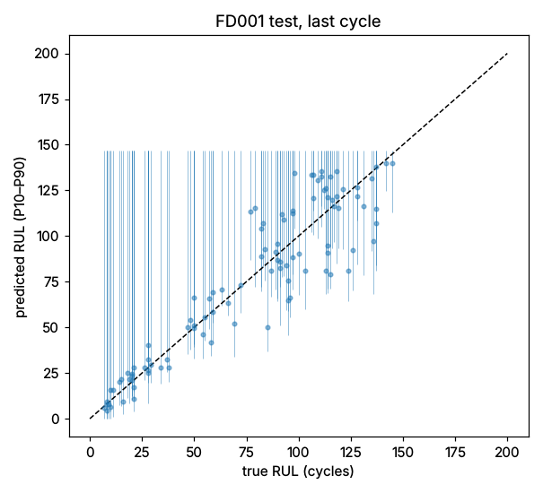
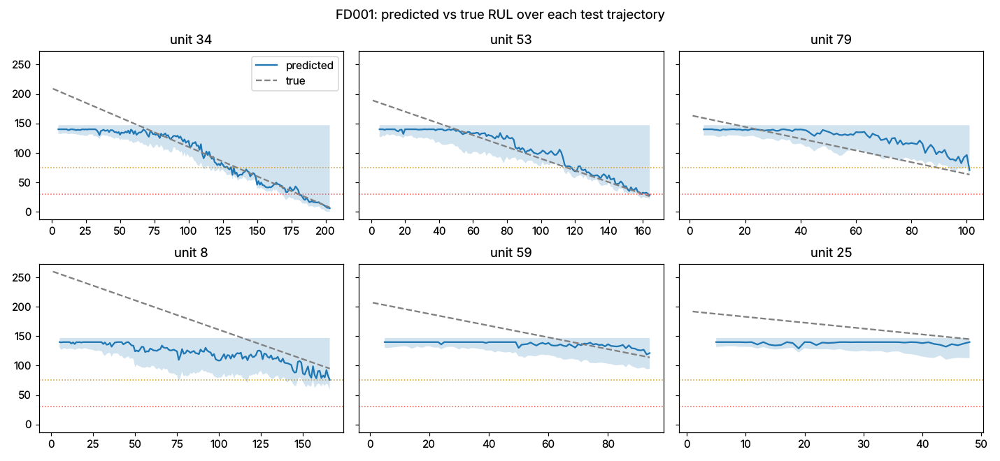

# Official test evaluation — FD001

> **Archived run 1** (bundle `20261120-p1`, CV truncation range 5–200). This was the first and only planned look at the official test set. Superseded by the post-hoc run in `../` — see `docs/05_ML_and_Data_Spec.md` §7.5.3.

Model `20261120-p1` · 100 test engines · last observed cycle vs `RUL_FD001.txt` (uncapped truth).
Selected config: `cap=140;n_sensors=14;min_child_samples=50,num_leaves=15` · conformal margin ±7.0 cycles.

| Metric | Value | Target |
|---|---|---|
| RMSE (cycles) | **16.20** | ≤ 16 ❌ |
| NASA score | **411** | ≤ 500 ✅ |
| MAE | 11.89 | |
| Bias (pred − true) | -0.11 | |
| Late by > 20 cycles | 11.0% | ≤ 10% |
| P10–P90 coverage | 94.0% | 75–90% |
| Mean interval width | 90.7 | |
| Critical recall | 0.92 | ≥ 0.90 |
| False Critical among healthy | 0.0% | ≤ 5% |
| CV RMSE LightGBM / Ridge | 20.60 / 26.24 | ≥ 15% better ✅ |

RMSE by true RUL: <=30: 5.1 · 31-75: 8.6 · 76-125: 20.8 · >125: 19.8

## Alert confusion (thresholds 75 / 30)

```
predicted  Healthy  Warning  Critical
true                                 
Healthy         54        3         0
Warning          0       16         2
Critical         0        2        23
```



