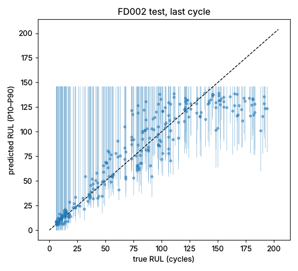
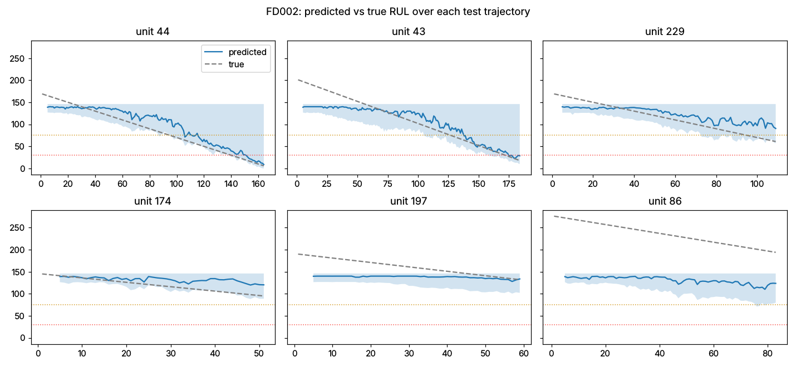

# Official test evaluation — FD002

> **Archived run 1** (bundle `20261120-p1`, CV truncation range 5–200). This was the first and only planned look at the official test set. Superseded by the post-hoc run in `../` — see `docs/05_ML_and_Data_Spec.md` §7.5.3.

Model `20261120-p1` · 259 test engines · last observed cycle vs `RUL_FD002.txt` (uncapped truth).
Selected config: `cap=140;n_sensors=14;min_child_samples=20,num_leaves=31` · conformal margin ±6.0 cycles.

| Metric | Value | Target |
|---|---|---|
| RMSE (cycles) | **22.80** | ≤ 22 ❌ |
| NASA score | **3962** | ≤ 3000 ❌ |
| MAE | 15.60 | |
| Bias (pred − true) | -4.06 | |
| Late by > 20 cycles | 9.7% | ≤ 10% |
| P10–P90 coverage | 80.3% | 75–90% |
| Mean interval width | 92.6 | |
| Critical recall | 0.97 | ≥ 0.90 |
| False Critical among healthy | 0.0% | ≤ 5% |
| CV RMSE LightGBM / Ridge | 22.89 / 27.28 | ≥ 15% better ✅ |

RMSE by true RUL: <=30: 3.9 · 31-75: 16.5 · 76-125: 18.8 · >125: 39.4

## Alert confusion (thresholds 75 / 30)

```
predicted  Healthy  Warning  Critical
true                                 
Healthy        127       12         0
Warning         15       42         2
Critical         0        2        59
```



