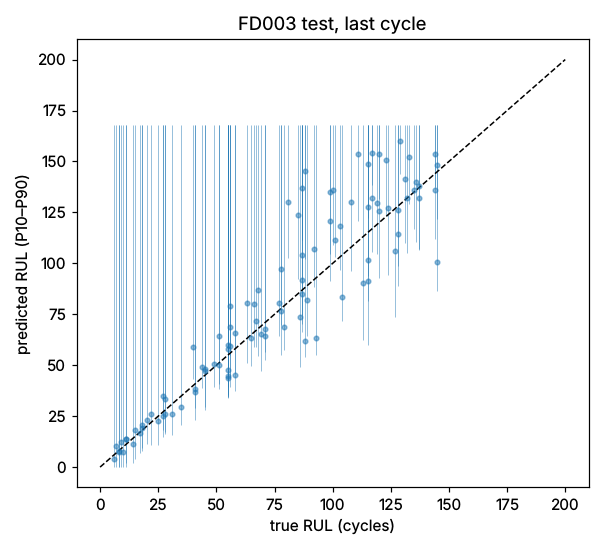
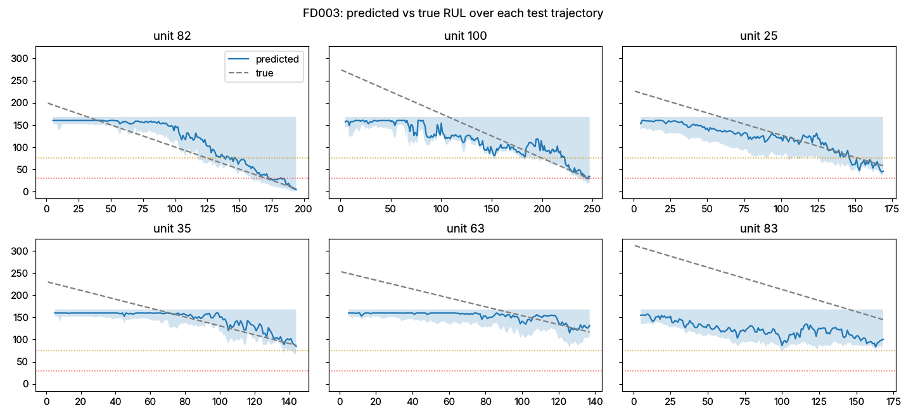

# Official test evaluation — FD003

> **Archived run 1** (bundle `20261120-p1`, CV truncation range 5–200). This was the first and only planned look at the official test set. Superseded by the post-hoc run in `../` — see `docs/05_ML_and_Data_Spec.md` §7.5.3.

Model `20261120-p1` · 100 test engines · last observed cycle vs `RUL_FD003.txt` (uncapped truth).
Selected config: `cap=160;n_sensors=15;min_child_samples=20,num_leaves=15` · conformal margin ±8.1 cycles.

| Metric | Value | Target |
|---|---|---|
| RMSE (cycles) | **17.93** | ≤ 16 ❌ |
| NASA score | **1085** | ≤ 600 ❌ |
| MAE | 12.46 | |
| Bias (pred − true) | +5.40 | |
| Late by > 20 cycles | 15.0% | ≤ 10% |
| P10–P90 coverage | 86.0% | 75–90% |
| Mean interval width | 106.7 | |
| Critical recall | 0.90 | ≥ 0.90 |
| False Critical among healthy | 0.0% | ≤ 5% |
| CV RMSE LightGBM / Ridge | 20.63 / 27.70 | ≥ 15% better ✅ |

RMSE by true RUL: <=30: 3.2 · 31-75: 10.0 · 76-125: 26.3 · >125: 16.8

## Alert confusion (thresholds 75 / 30)

```
predicted  Healthy  Warning  Critical
true                                 
Healthy         47        4         0
Warning          4       23         2
Critical         0        2        18
```



