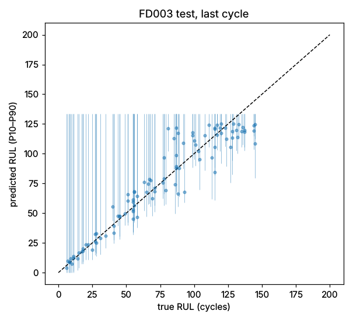
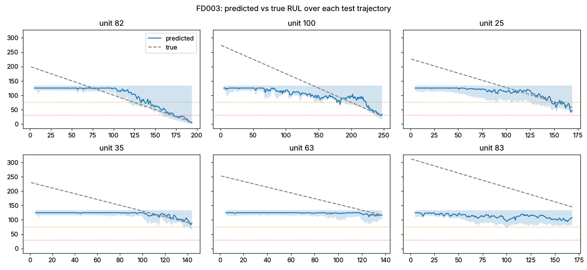

# Official test evaluation — FD003

> **Archived run 2, post-hoc** (bundle `20261120-p2`). Superseded by run 3 in `../` (P1.10). See `docs/05_ML_and_Data_Spec.md` §7.5.3–7.5.4.

Model `20261120-p2` · 100 test engines · last observed cycle vs `RUL_FD003.txt` (uncapped truth).
Selected config: `cap=125;n_sensors=15;min_child_samples=20,num_leaves=15` · conformal margin ±8.6 cycles.

| Metric | Value | Target |
|---|---|---|
| RMSE (cycles) | **12.83** | ≤ 16 ✅ |
| NASA score | **269** | ≤ 600 ✅ |
| MAE | 9.30 | |
| Bias (pred − true) | -0.24 | |
| Late by > 20 cycles | 4.0% | ≤ 10% |
| P10–P90 coverage | 87.0% | 75–90% |
| Mean interval width | 75.3 | |
| Critical recall | 0.90 | ≥ 0.90 |
| False Critical among healthy | 0.0% | ≤ 5% |
| CV RMSE LightGBM / Ridge | 14.89 / 19.48 | ≥ 15% better ✅ |

RMSE by true RUL: <=30: 2.9 · 31-75: 7.9 · 76-125: 16.1 · >125: 18.6

## Alert confusion (thresholds 75 / 30)

```
predicted  Healthy  Warning  Critical
true                                 
Healthy         47        4         0
Warning          3       25         1
Critical         0        2        18
```



