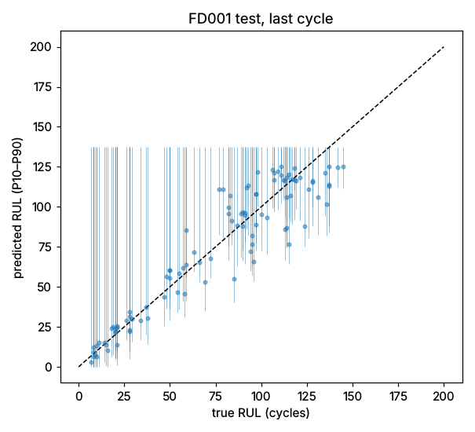
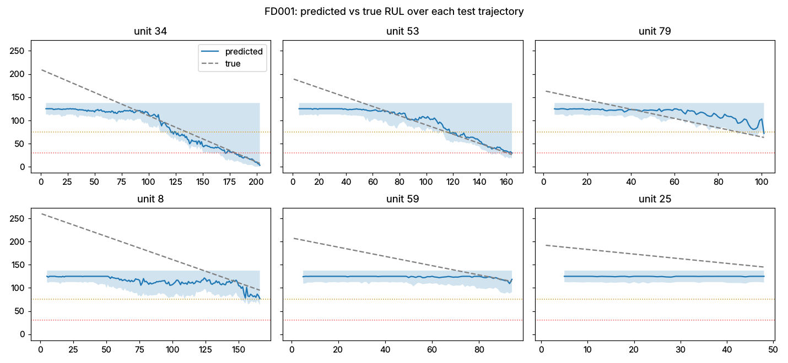

# Official test evaluation — FD001

> **Run 3, post-hoc** (bundle `20261120-p3`, plan step P1.10). Third look at the official test set; changes since run 2 were selected on CV only (feature window grid {30, 50, 70, 100}). See `docs/05_ML_and_Data_Spec.md` §7.5.4.

Model `20261120-p3` · 100 test engines · last observed cycle vs `RUL_FD001.txt` (uncapped truth).
Selected config: `cap=125;n_sensors=14;W=50,a=0.3;min_child_samples=20,num_leaves=31` · conformal margin ±12.4 cycles.

| Metric | Value | Target |
|---|---|---|
| RMSE (cycles) | **14.23** | ≤ 16 ✅ |
| NASA score | **284** | ≤ 500 ✅ |
| MAE | 10.72 | |
| Bias (pred − true) | -1.10 | |
| Late by > 20 cycles | 6.0% | ≤ 10% |
| P10–P90 coverage | 93.0% | 75–90% |
| Mean interval width | 82.0 | |
| Critical recall | 0.92 | ≥ 0.90 |
| False Critical among healthy | 0.0% | ≤ 5% |
| CV RMSE LightGBM / Ridge | 14.29 / 20.29 | ≥ 15% better ✅ |

RMSE by true RUL: <=30: 4.1 · 31-75: 9.8 · 76-125: 17.2 · >125: 20.2

## Alert confusion (thresholds 75 / 30)

```
predicted  Healthy  Warning  Critical
true                                 
Healthy         54        3         0
Warning          1       16         1
Critical         0        2        23
```



