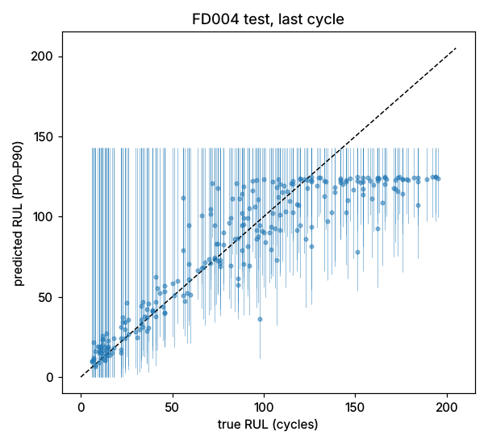
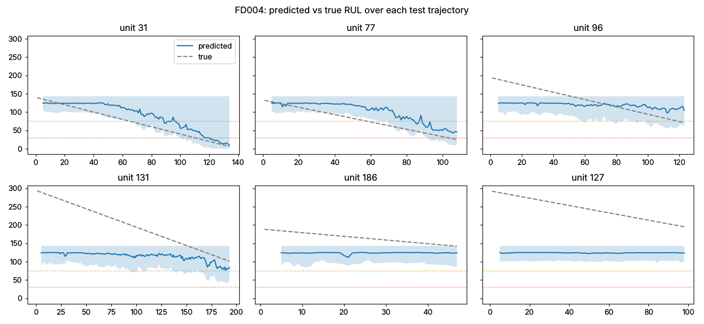

# Official test evaluation — FD004

> **Run 3, post-hoc** (bundle `20261120-p3`, plan step P1.10). Third look at the official test set; changes since run 2 were selected on CV only (feature window grid {30, 50, 70, 100}). See `docs/05_ML_and_Data_Spec.md` §7.5.4.

Model `20261120-p3` · 248 test engines · last observed cycle vs `RUL_FD004.txt` (uncapped truth).
Selected config: `cap=125;n_sensors=15;W=70,a=0.3;min_child_samples=50,num_leaves=31` · conformal margin ±18.0 cycles.

| Metric | Value | Target |
|---|---|---|
| RMSE (cycles) | **25.99** | ≤ 24 ❌ |
| NASA score | **4492** | ≤ 4500 ✅ |
| MAE | 18.21 | |
| Bias (pred − true) | -8.04 | |
| Late by > 20 cycles | 8.1% | ≤ 10% |
| P10–P90 coverage | 78.2% | 75–90% |
| Mean interval width | 93.1 | |
| Critical recall | 0.89 | ≥ 0.90 |
| False Critical among healthy | 0.0% | ≤ 5% |
| CV RMSE LightGBM / Ridge | 17.11 / 21.47 | ≥ 15% better ✅ |

RMSE by true RUL: <=30: 7.3 · 31-75: 16.6 · 76-125: 17.5 · >125: 43.6

## Alert confusion (thresholds 75 / 30)

```
predicted  Healthy  Warning  Critical
true                                 
Healthy        130       10         0
Warning         11       41         3
Critical         0        6        47
```



