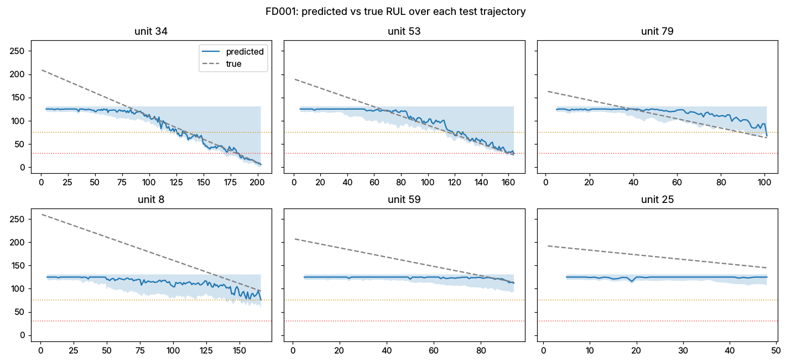

# Official test evaluation — FD001

> **Run 2, post-hoc** (bundle `20261120-p2`). Produced after the test set had been seen once in run 1 (archived in `run1_20261120-p1/`); only the CV validation range changed. See `docs/05_ML_and_Data_Spec.md` §7.5.3.

Model `20261120-p2` · 100 test engines · last observed cycle vs `RUL_FD001.txt` (uncapped truth).
Selected config: `cap=125;n_sensors=14;min_child_samples=20,num_leaves=15` · conformal margin ±5.7 cycles.

| Metric | Value | Target |
|---|---|---|
| RMSE (cycles) | **14.89** | ≤ 16 ✅ |
| NASA score | **293** | ≤ 500 ✅ |
| MAE | 11.16 | |
| Bias (pred − true) | -2.26 | |
| Late by > 20 cycles | 4.0% | ≤ 10% |
| P10–P90 coverage | 88.0% | 75–90% |
| Mean interval width | 73.8 | |
| Critical recall | 0.92 | ≥ 0.90 |
| False Critical among healthy | 0.0% | ≤ 5% |
| CV RMSE LightGBM / Ridge | 15.69 / 19.68 | ≥ 15% better ✅ |

RMSE by true RUL: <=30: 5.4 · 31-75: 8.2 · 76-125: 17.4 · >125: 23.8

## Alert confusion (thresholds 75 / 30)

```
predicted  Healthy  Warning  Critical
true                                 
Healthy         54        3         0
Warning          1       15         2
Critical         0        2        23
```



