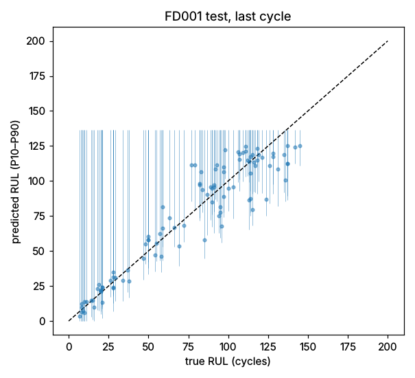

# Official test evaluation — FD001

Model `20261120-p5` · 100 test engines · last observed cycle vs `RUL_FD001.txt` (uncapped truth).
Selected config: `cap=125;n_sensors=14;W=50,a=0.3;min_child_samples=20,num_leaves=31` · conformal margin ±11.5 cycles.

| Metric | Value | Target |
|---|---|---|
| RMSE, uncapped truth | **13.81** | ≤ 16 ✅ |
| RMSE, truth capped at 125 | 12.68 |  |
| NASA score, uncapped | 268 | ≤ 500 ✅ |
| NASA score, capped at 125 | 239 |  |
| MAE | 10.35 | |
| Bias (pred − true) | -1.17 | |
| Late by > 20 cycles | 5.0% | ≤ 10% |
| P10–P90 coverage | 91.0% | 75–90% |
| Mean interval width | 79.9 | |
| Critical recall | 0.88 | ≥ 0.90 |
| False Critical among healthy | 0.0% | ≤ 5% |
| CV RMSE model / Ridge | 14.19 / 20.29 | ≥ 15% better ✅ |

RMSE by true RUL: <=30: 3.9 · 31-75: 9.3 · 76-125: 16.6 · >125: 20.2

## Alert confusion (thresholds 75 / 30)

```
predicted  Healthy  Warning  Critical
true                                 
Healthy         55        2         0
Warning          1       15         2
Critical         0        3        22
```



