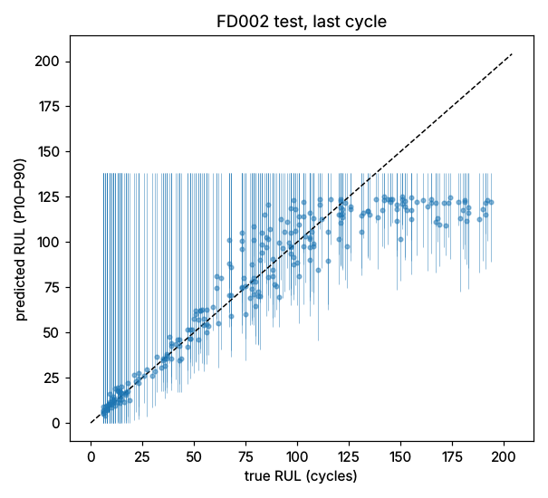

# Official test evaluation — FD002

Model `20261120-p6` · 259 test engines · last observed cycle vs `RUL_FD002.txt` (uncapped truth).
Selected config: `cap=125;n_sensors=14;W=100,a=0.3;min_child_samples=20,num_leaves=15` + M2 sequence model (point = mean) · conformal margin ±13.0 cycles.

| Metric | Value | Target |
|---|---|---|
| RMSE, uncapped truth | 23.04 |  |
| RMSE, truth capped at 125 | **10.04** | ≤ 22 ✅ |
| NASA score, uncapped | 3897 |  |
| NASA score, capped at 125 | 430 | ≤ 3000 ✅ |
| MAE | 14.53 | |
| Bias (pred − true) | -7.24 | |
| Late by > 20 cycles | 5.8% | ≤ 10% |
| P10–P90 coverage | 79.2% | 75–90% |
| Mean interval width | 85.7 | |
| Critical recall | 1.00 | ≥ 0.90 |
| False Critical among healthy | 0.0% | ≤ 5% |
| CV RMSE model / Ridge | 14.79 / 20.94 | ≥ 15% better ✅ |

RMSE by true RUL: <=30: 2.9 · 31-75: 10.7 · 76-125: 13.5 · >125: 45.0

## Alert confusion (thresholds 75 / 30)

```
predicted  Healthy  Warning  Critical
true                                 
Healthy        131        8         0
Warning         11       47         1
Critical         0        0        61
```



