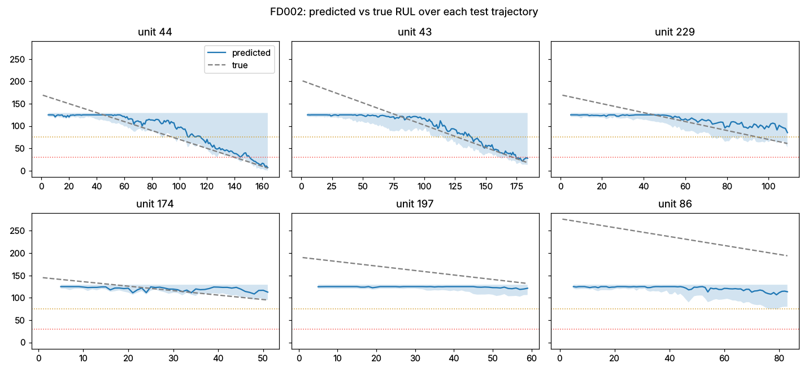

# Official test evaluation — FD002

> **Run 2, post-hoc** (bundle `20261120-p2`). Produced after the test set had been seen once in run 1 (archived in `run1_20261120-p1/`); only the CV validation range changed. See `docs/05_ML_and_Data_Spec.md` §7.5.3.

Model `20261120-p2` · 259 test engines · last observed cycle vs `RUL_FD002.txt` (uncapped truth).
Selected config: `cap=125;n_sensors=14;min_child_samples=50,num_leaves=15` · conformal margin ±4.2 cycles.

| Metric | Value | Target |
|---|---|---|
| RMSE (cycles) | **24.82** | ≤ 22 ❌ |
| NASA score | **5433** | ≤ 3000 ❌ |
| MAE | 16.66 | |
| Bias (pred − true) | -7.70 | |
| Late by > 20 cycles | 7.3% | ≤ 10% |
| P10–P90 coverage | 72.2% | 75–90% |
| Mean interval width | 73.7 | |
| Critical recall | 0.98 | ≥ 0.90 |
| False Critical among healthy | 0.0% | ≤ 5% |
| CV RMSE LightGBM / Ridge | 17.70 / 20.05 | ≥ 15% better ❌ |

RMSE by true RUL: <=30: 3.6 · 31-75: 15.4 · 76-125: 16.0 · >125: 46.6

## Alert confusion (thresholds 75 / 30)

```
predicted  Healthy  Warning  Critical
true                                 
Healthy        127       12         0
Warning         14       44         1
Critical         0        1        60
```



