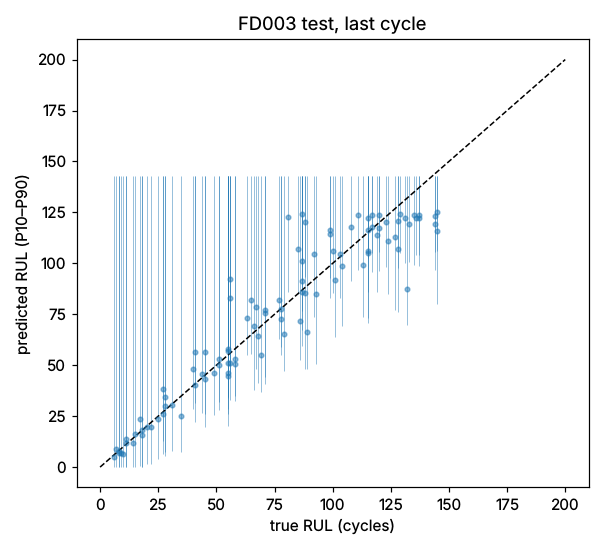
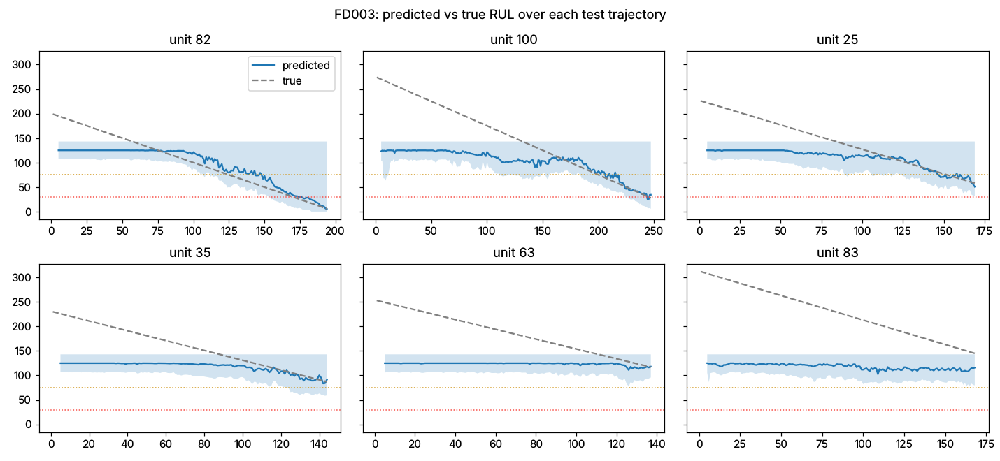

# Official test evaluation — FD003

Model `20261120-p5` · 100 test engines · last observed cycle vs `RUL_FD003.txt` (uncapped truth).
Selected config: `cap=125;n_sensors=15;W=100,a=0.3;min_child_samples=50,num_leaves=31` · conformal margin ±18.0 cycles.

| Metric | Value | Target |
|---|---|---|
| RMSE, uncapped truth | **13.29** | ≤ 16 ✅ |
| RMSE, truth capped at 125 | 11.74 |  |
| NASA score, uncapped | 333 | ≤ 600 ✅ |
| NASA score, capped at 125 | 289 |  |
| MAE | 9.36 | |
| Bias (pred − true) | -0.46 | |
| Late by > 20 cycles | 6.0% | ≤ 10% |
| P10–P90 coverage | 93.0% | 75–90% |
| Mean interval width | 90.8 | |
| Critical recall | 0.90 | ≥ 0.90 |
| False Critical among healthy | 0.0% | ≤ 5% |
| CV RMSE model / Ridge | 14.60 / 19.50 | ≥ 15% better ✅ |

RMSE by true RUL: <=30: 3.6 · 31-75: 11.4 · 76-125: 14.6 · >125: 19.9

## Alert confusion (thresholds 75 / 30)

```
predicted  Healthy  Warning  Critical
true                                 
Healthy         47        4         0
Warning          6       22         1
Critical         0        2        18
```



