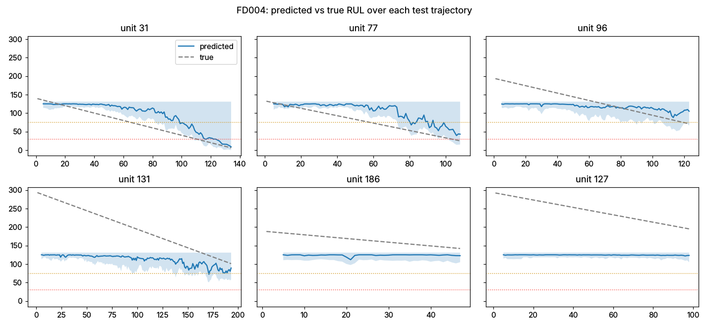

# Official test evaluation — FD004

Model `20261120-p1` · 248 test engines · last observed cycle vs `RUL_FD004.txt` (uncapped truth).
Selected config: `cap=160;n_sensors=15;min_child_samples=50,num_leaves=31` · conformal margin ±5.0 cycles.

| Metric | Value | Target |
|---|---|---|
| RMSE (cycles) | **22.61** | ≤ 24 ✅ |
| NASA score | **4395** | ≤ 4500 ✅ |
| MAE | 16.41 | |
| Bias (pred − true) | +0.91 | |
| Late by > 20 cycles | 14.5% | ≤ 10% |
| P10–P90 coverage | 81.9% | 75–90% |
| Mean interval width | 100.7 | |
| Critical recall | 0.81 | ≥ 0.90 |
| False Critical among healthy | 0.0% | ≤ 5% |
| CV RMSE LightGBM / Ridge | 24.56 / 30.88 | ≥ 15% better ✅ |

RMSE by true RUL: <=30: 8.3 · 31-75: 20.1 · 76-125: 23.1 · >125: 30.4

## Alert confusion (thresholds 75 / 30)

```
predicted  Healthy  Warning  Critical
true                                 
Healthy        132        8         0
Warning         17       34         4
Critical         0       10        43
```



