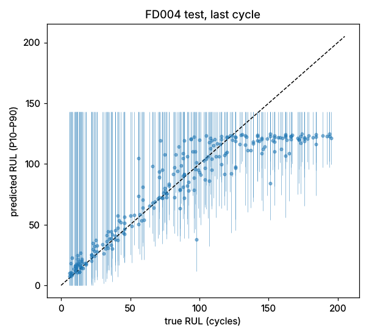

# Official test evaluation — FD004

Model `20261120-p4` · 248 test engines · last observed cycle vs `RUL_FD004.txt` (uncapped truth).
Selected config: `cap=125;n_sensors=15;W=70,a=0.3;min_child_samples=50,num_leaves=31` + M2 sequence model (point = mean) · conformal margin ±18.0 cycles.

| Metric | Value | Target |
|---|---|---|
| RMSE, uncapped truth | 24.69 |  |
| RMSE, truth capped at 125 | **11.87** | ≤ 24 ✅ |
| NASA score, uncapped | 3761 |  |
| NASA score, capped at 125 | 767 | ≤ 4500 ✅ |
| MAE | 16.57 | |
| Bias (pred − true) | -7.99 | |
| Late by > 20 cycles | 5.6% | ≤ 10% |
| P10–P90 coverage | 78.2% | 75–90% |
| Mean interval width | 93.1 | |
| Critical recall | 0.91 | ≥ 0.90 |
| False Critical among healthy | 0.0% | ≤ 5% |
| CV RMSE model / Ridge | 15.84 / 21.47 | ≥ 15% better ✅ |

RMSE by true RUL: <=30: 5.7 · 31-75: 13.7 · 76-125: 15.1 · >125: 42.7

## Alert confusion (thresholds 75 / 30)

```
predicted  Healthy  Warning  Critical
true                                 
Healthy        135        5         0
Warning         11       43         1
Critical         0        5        48
```



